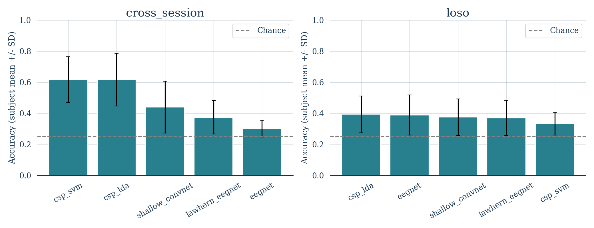

# Verified Benchmark Results

Completed folds: 90.

| Protocol | Model | Accuracy +/- SD (%) | Macro-F1 +/- SD (%) |
|---|---|---:|---:|
| cross_session | csp_lda | 61.65 +/- 16.99 | 58.85 +/- 19.52 |
| cross_session | csp_svm | 61.69 +/- 14.79 | 59.12 +/- 16.98 |
| cross_session | eegnet | 30.09 +/- 5.39 | 26.42 +/- 7.40 |
| cross_session | lawhern_eegnet | 37.42 +/- 10.74 | 33.39 +/- 12.60 |
| cross_session | shallow_convnet | 44.02 +/- 16.69 | 41.88 +/- 18.81 |
| loso | csp_lda | 39.31 +/- 11.90 | 34.67 +/- 13.49 |
| loso | csp_svm | 33.29 +/- 7.30 | 27.83 +/- 7.78 |
| loso | eegnet | 38.91 +/- 12.98 | 34.47 +/- 15.09 |
| loso | lawhern_eegnet | 36.98 +/- 11.45 | 31.48 +/- 13.38 |
| loso | shallow_convnet | 37.52 +/- 11.76 | 34.33 +/- 13.63 |

## Paired EEGNet versus CSP-LDA comparison

- cross_session: -24.23 percentage points; descriptive subject-bootstrap 95% interval [-32.18, -15.93]; exploratory sign-flip p=0.0039.
- loso: -2.33 percentage points; descriptive subject-bootstrap 95% interval [-9.07, 4.01]; exploratory sign-flip p=0.5234.

These are exploratory, unadjusted comparisons on nine subjects. LOSO training sets overlap,
so folds are not independent replications. Intervals are descriptive, not confirmatory evidence.
A single seed does not measure training-seed uncertainty. No causal explanation follows
from the model ranking alone. Model reload predictions matched in-memory predictions for every fold.

